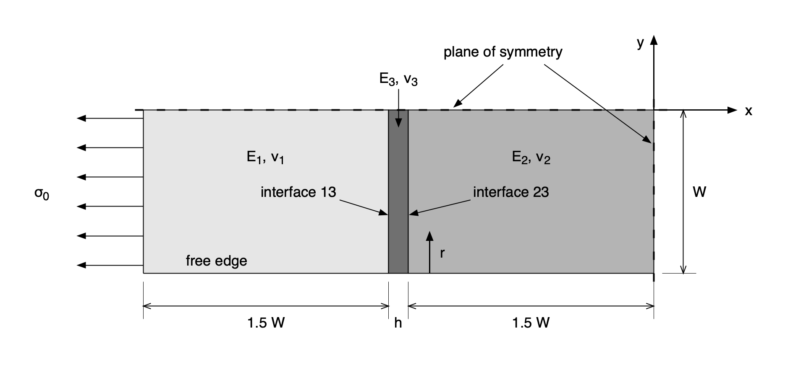
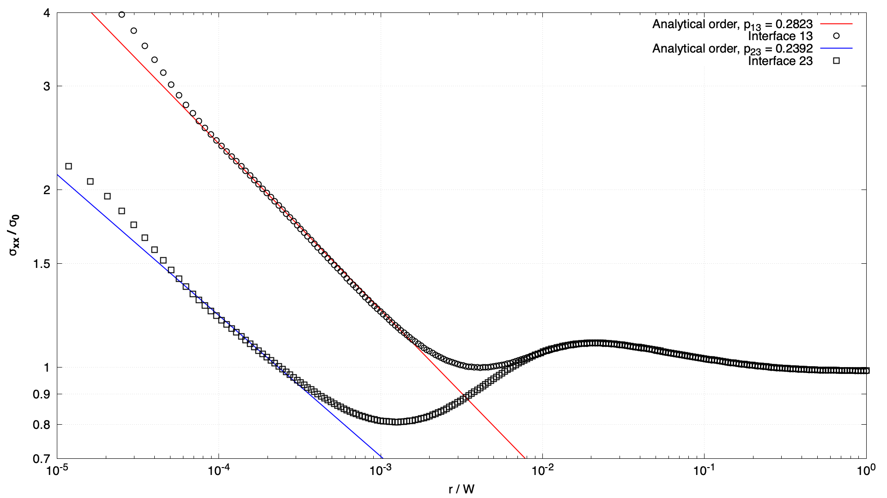
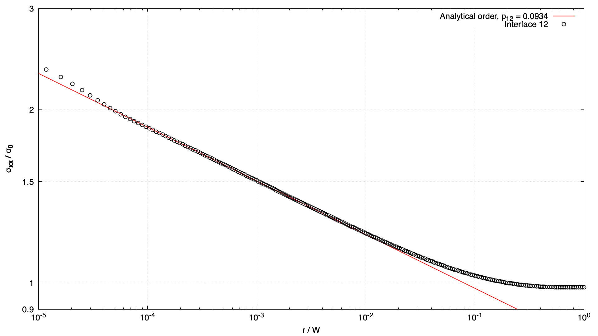
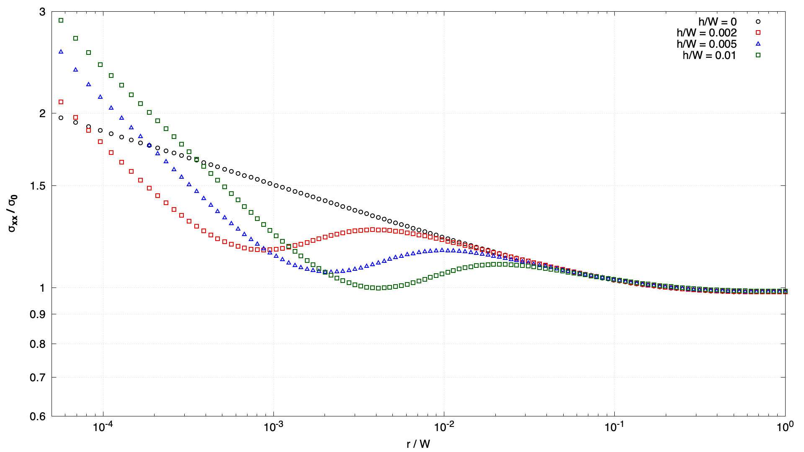
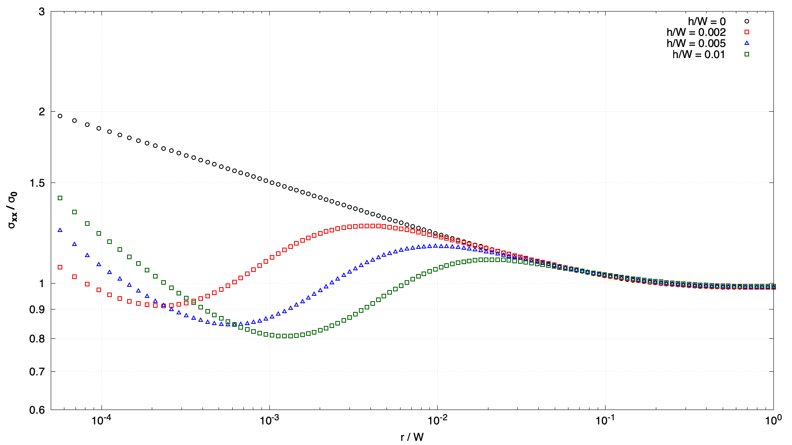

# Free-edge stress singularity in a multi-material plate: `multiMaterialPlate`

---

Prepared by Ivan Batistić

---

## Tutorial Aims

- Demonstrate the solution of a solid mechanics problem with three materials
  bonded along two interfaces;
- Examine the stress singularity where an interface between two materials
  meets a free edge;
- Compare the order of the singularity predicted by a solid model against the
  available analytical solution.

---

## Case Overview

This case analyses a plate made of two materials that are bonded through a thin
mid-layer of a third material and loaded in tension [1, 2] (Figure 1). The
specimen has a width of $$2W$$, with $$W = 30$$ mm, and each of the outer
materials has a length of $$1.5W$$. The mid-layer thickness $$h$$ is the only
variable geometry parameter: $$h = 0.002W$$, $$0.005W$$ or $$0.01W$$, or
$$h = 0$$, where materials 1 and 2 are bonded directly. Because of symmetry,
one quarter of the specimen is modelled, with symmetry planes at the top and
right boundaries; the origin of the coordinate system is at their intersection.
The left boundary has a prescribed tensile stress $$\sigma_0 = 1$$ MPa, and the
bottom boundary is a stress-free edge. The problem is considered _plane
strain_ and is simulated as a steady state using one loading step. The material
properties are given in Table 1.



Figure 1: Problem geometry (the mid-layer thickness is exaggerated)

Table 1: Material properties [1]

| Property | Material 1 | Material 2 | Material 3 |
| --- | --- | --- | --- |
| $$E$$, GPa | 206.0 | 70.3 | 4.93 |
| $$\nu$$ | 0.300 | 0.345 | 0.330 |

The mesh follows [1]. There are $$240$$ cells in the $$y$$ direction and
$$120$$ cells in the $$x$$ direction in each of materials 1 and 2. These cells
are graded towards the interfaces and towards the free edge, with a ratio of
$$10000$$ between the largest and the smallest cell, so that the cells where an
interface meets the free edge are a fraction of a micrometre in size. The
mid-layer is uniform in the $$x$$ direction, with $$250$$ cells for
$$h = 0.002W$$ and $$h = 0.005W$$, and $$500$$ cells for $$h = 0.01W$$. This
results in $$57\,600$$ cells for $$h = 0$$, $$117\,600$$ cells for
$$h = 0.002W$$ and $$h = 0.005W$$, and $$177\,600$$ cells for $$h = 0.01W$$.

---

## Running the Case

The case can be run using the included `Allrun` script, i.e. `> ./Allrun`,
which runs the plate with the thickest mid-layer, $$h = 0.01W$$. The other
thicknesses are selected by passing $$h/W$$ to the script:

```bash
./Allrun 0.002
./Allrun 0.005
./Allrun 0.01
./Allrun 0
```

Run `> ./Allclean` before selecting another thickness. The `Allrun` script
first creates the dictionaries that depend on the mid-layer thickness:

- `system/blockMeshDict` from `system/blockMeshDict.m4`, using `m4`;
- `system/sample` from `system/sample.m4`, using `m4`, and its copy
  `system/sampleDict`, which foam-extend reads instead;
- `constant/mechanicalProperties` from
  `constant/mechanicalProperties.threeMaterials`, or from
  `constant/mechanicalProperties.twoMaterials` if $$h = 0$$.

It then creates the mesh using `blockMesh` (`> blockMesh`) and runs the
`solids4Foam` solver (`> solids4Foam`). As the last step, the `sample` utility
is used to extract the stress along the interfaces. Optionally, if `gnuplot` is
installed, the stress distributions are plotted in the `sigmaxx.png` file. The
run takes from about 20 s for $$h = 0$$ to about 2 min for $$h = 0.01W$$ on
one processor.

Each block in `system/blockMeshDict.m4` is given the name of its material:

```c++
blocks
(
    hex (L0 A0 A1 L1 L2 A2 A3 L3) material1 (nxSide ny 1) ...
    hex (B0 R0 R1 B1 B2 R2 R3 B3) material2 (nxSide ny 1) ...
    hex (A0 B0 B1 A1 A2 B2 B3 A3) material3 (nxMid ny 1) ...
);
```

so `blockMesh` writes the `material1`, `material2` and `material3` cell zones
itself, and no further utility is needed to create them.

```note
For multi-material cases, solids4foam expects to find a cellZone for each
material defined in constant/mechanicalProperties, where the cellZone name is
assumed to be the same as the material name in constant/mechanicalProperties.
```

The materials share one mesh, and the gradient of the displacement is taken
with the material-aware `leastSquaresS4f` scheme, which keeps each cell's
stencil within its own material; any case with more than one material needs
it.

---

## Expected Results

The stress is singular where an interface between two materials meets the free
edge. Close to this point, the normal stress on the interface varies with the
distance $$r$$ from the free edge as

$$
\sigma_{xx} \approx K r^{-p},
$$

where $$K$$ is the intensity and $$p$$ is the order of the singularity. The
order depends only on the elastic properties of the two bonded materials,
$$a$$ and $$b$$, and is found from the root $$\lambda = 1 - p$$ of the
characteristic equation for two bonded quarter planes [3]:

$$
\lambda^2 \left( \lambda^2 - 1 \right) \alpha^2
+ 2 \lambda^2 \left[ \sin^2 \left( \frac{\pi \lambda}{2} \right)
- \lambda^2 \right] \alpha \beta
+ \left[ \sin^2 \left( \frac{\pi \lambda}{2} \right)
- \lambda^2 \right]^2 \beta^2
+ \sin^2 \left( \frac{\pi \lambda}{2} \right)
\cos^2 \left( \frac{\pi \lambda}{2} \right) = 0,
$$

where $$\alpha$$ and $$\beta$$ are the Dundurs' parameters:

$$
\alpha = \frac{m_b - k m_a}{m_b + k m_a},
\qquad
\beta = \frac{\left( m_b - 2 \right) - k \left( m_a - 2 \right)}
{m_b + k m_a},
$$

with $$k = \mu_b / \mu_a$$, where $$\mu$$ is the shear modulus, and
$$m_i = 4 \left( 1 - \nu_i \right)$$ for plane strain. The orders of the
singularity for the three pairs of materials in Table 1 are given in Table 2.

Table 2: Order of the stress singularity

| Interface | Materials | $$p$$ |
| --- | --- | --- |
| 12 | 1 and 2 | 0.0934 |
| 13 | 1 and 3 | 0.2823 |
| 23 | 2 and 3 | 0.2392 |

Figure 2 shows the normal stress $$\sigma_{xx}$$ along the two interfaces for
$$h = 0.01W$$, together with the singular term $$K r^{-p}$$ drawn with the
analytical order from Table 2 and an intensity $$K$$ fitted to the numerical
stress in $$10^{-4} < r/W < 3 \times 10^{-4}$$. Close to the free edge, the
stress on each interface follows the singular term of its own pair of
materials. Further from the free edge, the two distributions merge, as the
mid-layer becomes thin compared with $$r$$, and the stress approaches the
applied stress $$\sigma_0$$. The cells closest to the singular point,
$$r/W < 5 \times 10^{-5}$$, depart from the singular term, as the stress there
is not resolved by the mesh. For the thinner mid-layers, the singular term of
interface 23 dominates only closer to the free edge than the mesh resolves, so
the line drawn for interface 23 is then only indicative.



Figure 2: Normal stress along the interfaces for $$h = 0.01W$$

Figure 3 shows the corresponding result for $$h = 0$$, where there is a single
interface between materials 1 and 2. The weaker singularity of this pair of
materials is followed over more than two decades of $$r$$.



Figure 3: Normal stress along the interface for $$h = 0$$

The plots above are created automatically within the `Allrun` script using
the `sample` utility and `gnuplot`. Figures 4 and 5 collect the results of the
four runs, one for each mid-layer thickness, and can be compared with the
distributions given in [1, 2]. The thinner the mid-layer, the closer to the
free edge the stress leaves the distribution of the bi-material plate
($$h = 0$$).



Figure 4: Normal stress along interface 13 for the four mid-layer thicknesses



Figure 5: Normal stress along interface 23 for the four mid-layer thicknesses

The stress is sampled along lines that run from the free edge to the symmetry
plane, $$0.05$$ $$\mu$$m to the side of each interface:

```c++
interpolationScheme cellPointFace;

fields
(
    sigma
);

sets
(
    interface13
    {
        type            face;
        axis            y;
        start           (-0.04530005 -0.03 0.0005);
        end             (-0.04530005 0 0.0005);
    }
    interface23
    {
        type            face;
        axis            y;
        start           (-0.04499995 -0.03 0.0005);
        end             (-0.04499995 0 0.0005);
    }
);
```

The `cellPointFace` scheme interpolates the stress from the cells on both
sides of the interface. This is appropriate for the normal stress
$$\sigma_{xx}$$, which is continuous across the interface, but not for the
$$\sigma_{yy}$$ and $$\sigma_{zz}$$ components, which are not.

---

### References

[1]
[Ž. Tuković, A. Ivanković, and A. Karač, “Finite-volume stress analysis in
multi-material linear elastic body,” International Journal for Numerical
Methods in Engineering, vol. 93, no. 4, pp. 400–419,
2013.](https://repozitorij.fsb.hr/4072/1/Finite_Tukovic.pdf)

[2] S. Ioka, K. Masuda, and S. Kubo, “Singular stress field near the edge of
interface of bonded dissimilar materials with an interlayer,” International
Journal of Solids and Structures, vol. 44, pp. 6232–6238, 2007.

[3] D. B. Bogy, “On the problem of edge-bonded elastic quarter-planes loaded
at the boundary,” International Journal of Solids and Structures, vol. 6,
pp. 1287–1313, 1970.
